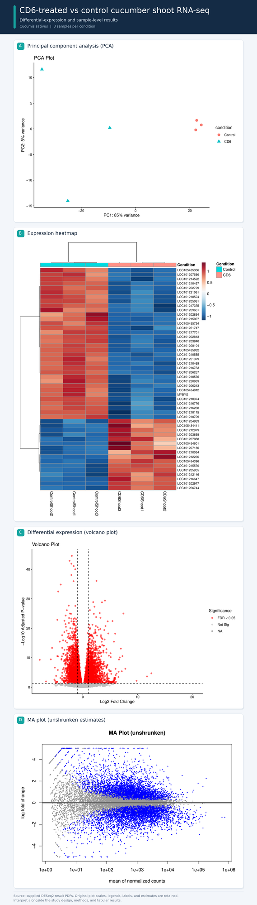

# Workflow Description Language (WDL) - based pipeline for RNA-Seq analysis to understand Cadmium toxicity in plants 


## Research team: 

This project was conducted through a collaboration between Horizon Science Communication LLC and the University of Massachusetts, USA and National Research Center, Egypt.


Horizon Science Communication LLC — Bioinformatics Team:

- **Hesham Abdullah, PhD**
- **Alaa El-minisy, PhD**


## Key Results

Multi-panel overview of the CD6-treated versus control *Cucumis sativus* RNA-seq results

<p align="center">
  
</p>
<p align="center"><em>Figure 1. Summary of DESeq2 results for CD6-treated vs control shoots.</em></p>

Figure 1. Sample-level and differential-expression summaries for three CD6-treated and three control cucumber-shoot samples. Panels show principal component analysis, the expression heatmap, the differential-expression volcano plot, and the unshrunken MA plot. See the accompanying methods and result tables for analysis details and gene-level estimates.

## Table of contents

- [Project overview](#project-overview)
- [Project objectives](#project-objectives)
- [Dataset overview](#dataset-overview)
- [Why WDL, Cromwell, and SLURM?](#why-wdl-cromwell-and-slurm)
- [Workflow overview](#workflow-overview)
- [Repository structure](#repository-structure)
- [Highlights](#highlights)
- [Results showcase](#results-showcase)
- [Software environment](#software-environment)
- [Running the workflow](#running-the-workflow)
- [WDL workflow stages](#wdl-workflow-stages)
- [Expected outputs](#expected-outputs)
- [Interpreting results](#interpreting-results)
- [Experimental design notes](#experimental-design-notes)
- [Troubleshooting](#troubleshooting)
- [Reusable preflight check](#reusable-preflight-check)
- [Future runs](#future-runs)
- [Successful run and output locations](#successful-run-and-output-locations)
- [Packaging and archiving results](#packaging-and-archiving-results)
- [Completion checklist](#completion-checklist)

## Project overview

This runbook documents the complete bulk RNA-Seq workflow for comparing:

- **CD6-treated shoot:** 3 biological replicates
- **Untreated control shoot:** 3 biological replicates
- **Sequencing layout:** paired-end FASTQ files
- **Primary contrast:** `CD6 - Control`
- **DESeq2 design:** `~ condition`

The workflow is executed with [`ww-rnaseq.wdl`](https://github.com/HABIOTECH/wilds-wdl-library/tree/main/pipelines/ww-rnaseq) through Cromwell and SLURM. It performs read QC, adapter trimming, STAR alignment, RSeQC alignment QC, count assembly, DESeq2 analysis, and MultiQC reporting.

> **Important reference check:** The downloaded assembly `GCF_000004075.2_ASM407v2` is identified by NCBI as *Cucumis sativus* (cucumber). Confirm that the RNA-Seq reads are from cucumber before interpreting mapping or differential-expression results. If the reads are from another species, replace the reference FASTA and annotation before running the workflow.

---

## Project objectives

The objective is to compare gene expression between CD6-treated and untreated control shoots using six paired-end RNA-seq libraries, with DESeq2 configured for the `CD6 - Control` contrast and a `~ condition` design.

The WDL workflow source is maintained in the [WILDS WDL library RNA-seq pipeline](https://github.com/HABIOTECH/wilds-wdl-library/tree/main/pipelines/ww-rnaseq). This repository also contains the standalone DESeq2 analysis script and selected input data, QC reports, result tables, and figures. Confirm that all external workflow files and environment-specific configuration are available before attempting a fresh end-to-end run.

## Dataset overview

### Input samples

The six libraries are:

| Sample | Condition | Tissue | Read 1 | Read 2 |
|---|---|---|---|---|
| `CD6Shoot1` | `CD6` | Shoot | `CD6Shoot1_1.fastq.gz` | `CD6Shoot1_2.fastq.gz` |
| `CD6Shoot2` | `CD6` | Shoot | `CD6Shoot2_1.fastq.gz` | `CD6Shoot2_2.fastq.gz` |
| `CD6Shoot3` | `CD6` | Shoot | `CD6Shoot3_1.fastq.gz` | `CD6Shoot3_2.fastq.gz` |
| `ControlShoot1` | `Control` | Shoot | `ControlShoot1_1.fastq.gz` | `ControlShoot1_2.fastq.gz` |
| `ControlShoot2` | `Control` | Shoot | `ControlShoot2_1.fastq.gz` | `ControlShoot2_2.fastq.gz` |
| `ControlShoot3` | `Control` | Shoot | `ControlShoot3_1.fastq.gz` | `ControlShoot3_2.fastq.gz` |

Each paired FASTQ pair represents one biological library. Read 1 and read 2 must not be treated as separate replicates.

---

### Create the tab-delimited sample sheet

The WDL reads the sample sheet with `read_tsv`, so the file must contain real tab characters. Generate it with Python rather than manually spacing columns:

```bash
python3 - <<PY
import csv

out = "${DATA_ROOT}/samples.tsv"

rows = [
    ["name", "r1", "r2", "condition"],
    ["CD6Shoot1",
     "${DATA_ROOT}/CD6Shoot1_1.fastq.gz",
     "${DATA_ROOT}/CD6Shoot1_2.fastq.gz",
     "CD6"],
    ["CD6Shoot2",
     "${DATA_ROOT}/CD6Shoot2_1.fastq.gz",
     "${DATA_ROOT}/CD6Shoot2_2.fastq.gz",
     "CD6"],
    ["CD6Shoot3",
     "${DATA_ROOT}/CD6Shoot3_1.fastq.gz",
     "${DATA_ROOT}/CD6Shoot3_2.fastq.gz",
     "CD6"],
    ["ControlShoot1",
     "${DATA_ROOT}/ControlShoot1_1.fastq.gz",
     "${DATA_ROOT}/ControlShoot1_2.fastq.gz",
     "Control"],
    ["ControlShoot2",
     "${DATA_ROOT}/ControlShoot2_1.fastq.gz",
     "${DATA_ROOT}/ControlShoot2_2.fastq.gz",
     "Control"],
    ["ControlShoot3",
     "${DATA_ROOT}/ControlShoot3_1.fastq.gz",
     "${DATA_ROOT}/ControlShoot3_2.fastq.gz",
     "Control"],
]

with open(out, "w", newline="") as f:
    csv.writer(f, delimiter="\t", lineterminator="\n").writerows(rows)

print(f"Wrote {out}")
PY
```

Validate the sample sheet:

```bash
awk -F'\t' '
NF != 4 {
    print "Incorrect field count on line " NR ": " NF
    exit 1
}
END {
    if (NR == 7)
        print "Sample sheet is valid: 6 samples plus header."
    else {
        print "Expected 7 lines including header; found " NR
        exit 1
    }
}
' ${DATA_ROOT}/samples.tsv
```

Confirm that tabs are present:

```bash
cat -A ${DATA_ROOT}/samples.tsv
```

Each row should contain `^I` between columns.

Validate all FASTQ paths:

```bash
python3 - <<PY
import csv
import gzip
from pathlib import Path

manifest = Path("${DATA_ROOT}/samples.tsv")

with manifest.open() as f:
    rows = list(csv.DictReader(f, delimiter="\t"))

assert len(rows) == 6, f"Expected 6 samples, found {len(rows)}"

for row in rows:
    for key in ("r1", "r2"):
        path = Path(row[key])
        assert path.is_file(), f"Missing file: {path}"
        with gzip.open(path, "rb") as handle:
            handle.read(1)

print("All six samples and twelve readable gzip-compressed FASTQ files are valid.")
PY
```

Optional gzip-integrity check:

```bash
while IFS=$'\t' read -r name r1 r2 condition; do
    [[ "$name" == "name" ]] && continue
    gzip -t "$r1" || exit 1
    gzip -t "$r2" || exit 1
done < "${DATA_ROOT}/samples.tsv"
```

---

## Why WDL, Cromwell, and SLURM?

WDL describes the workflow tasks and dependencies, Cromwell executes and tracks the workflow, and the SLURM backend submits individual tasks to the HPC scheduler. This separates workflow logic from cluster scheduling and supports reproducible, resource-configured execution.

The pipeline covers reference-annotation preparation, read-level QC, adapter trimming, STAR alignment, alignment QC with RSeQC, count-matrix assembly, DESeq2 analysis, result compilation, MultiQC aggregation, and optional output organization.

## Workflow overview

```text
Paired-end FASTQ files + sample sheet + reference FASTA/GTF
                         |
                         v
                 GTF normalization
                         |
                         v
               Pre-trim FastQC
                         |
                         v
                Adapter trimming
                         |
                         v
               Post-trim FastQC
                         |
                         v
                STAR alignment
                         |
                         v
                  RSeQC QC
                         |
                         v
            Count matrix + metadata
                         |
                         v
                 DESeq2 analysis
                         |
                         v
          Compiled results + MultiQC
                         |
                         v
             Organized result outputs
```

The detailed task descriptions, expected files, and execution notes are retained in the **WDL workflow stages** and **Expected outputs** sections below.

## Repository structure

The committed repository is organized around the analysis inputs, script, QC reports, and results:

```text
WDL-RNA-Seq-Runbook-CD6-Treated-vs-Control-Shoots/
├── README.md
├── .gitignore
├── data/
│   ├── combined_counts_matrix.txt
│   ├── sample_metadata.txt
│   └── reference/
│       └── normalized.gtf
├── scripts/
│   └── deseq2_analysis.R
├── qc/
│   ├── multiqc_report.html
│   └── multiqc_report_data.zip
└── results/
    ├── differential_expression/
    │   ├── cd6_vs_control_all_genes.csv
    │   ├── cd6_vs_control_normalized_counts.csv
    │   ├── cd6_vs_control_significant.csv
    │   └── additional DESeq2 result tables
    └── figures/
        ├── cd6_vs_control_heatmap.pdf
        ├── cd6_vs_control_ma_plot.pdf
        ├── cd6_vs_control_pca.pdf
        └── cd6_vs_control_volcano.pdf
```

The full WDL source, Cromwell configuration, and input JSON are referenced in the runbook but are not shown in the committed file tree above. The WDL source is linked in the project objectives section; cluster-specific configuration and file paths must be supplied for a new HPC run.

## Highlights

- Six biological libraries: three CD6-treated and three Control shoot samples.
- Paired-end FASTQ input and a tab-delimited sample manifest.
- WDL orchestration through Cromwell with SLURM task submission.
- Read QC before and after adapter trimming.
- STAR alignment and RSeQC alignment-quality assessment.
- DESeq2 differential-expression testing for `condition,CD6,Control`.
- MultiQC reporting and optional organization of delivery-ready outputs.
- A standalone R script and selected results are included for reviewing the DESeq2 analysis separately from the full WDL workflow.

## Results showcase

The committed analysis outputs include the differential-expression tables and four principal visualizations:

| Output | File |
|---|---|
| All-gene differential-expression results | [`cd6_vs_control_all_genes.csv`](results/differential_expression/cd6_vs_control_all_genes.csv) |
| Normalized counts | [`cd6_vs_control_normalized_counts.csv`](results/differential_expression/cd6_vs_control_normalized_counts.csv) |
| Significant results | [`cd6_vs_control_significant.csv`](results/differential_expression/cd6_vs_control_significant.csv) |
| PCA | [`cd6_vs_control_pca.pdf`](results/figures/cd6_vs_control_pca.pdf) |
| Heatmap | [`cd6_vs_control_heatmap.pdf`](results/figures/cd6_vs_control_heatmap.pdf) |
| MA plot | [`cd6_vs_control_ma_plot.pdf`](results/figures/cd6_vs_control_ma_plot.pdf) |
| Volcano plot | [`cd6_vs_control_volcano.pdf`](results/figures/cd6_vs_control_volcano.pdf) |
| MultiQC report | [`multiqc_report.html`](qc/multiqc_report.html) |

The committed standalone DESeq2 run retained 18,222 genes after filtering and reported 8,024 genes with adjusted p-value below 0.05. These values should be interpreted only after confirming the organism/reference identity, sample-level QC, replicate relationships, and the assumptions described later in this README.

## Software environment

The final working environment uses:

| Purpose | Software | Source |
|---|---|---|
| WDL execution | Cromwell 87 | `${BIN_ROOT}/cromwell-87.jar` |
| WDL validation | Womtool 87 | `${BIN_ROOT}/womtool-87.jar` |
| Java runtime | Java 11.0.2 | HPCC module |
| GTF normalization | gffread 0.12.7 | `${BIN_ROOT}` |
| Adapter trimming | Trim Galore 0.6.10 | `${BIN_ROOT}` |
| Adapter trimming dependency | Cutadapt 2.1 | HPCC module |
| Raw-read QC | FastQC 0.11.5 | HPCC module |
| Alignment | STAR 2.7.3a | HPCC module |
| Gene counting | featureCounts 2.0.5 | Subread module |
| BAM utilities | Samtools 1.21 | HPCC module |
| Alignment QC | RSeQC 5.0.5 | `multiqc_env` Conda environment |
| BED conversion support | Bedtools 2.27.1 | HPCC module |
| Differential expression | R 4.5.3 + DESeq2 1.50.2 | `rnaseq_r` Conda environment |
| Report aggregation | MultiQC 1.35 | `multiqc_env` Conda environment |

Check the complete environment on a compute node:

```bash
module load fastqc/0.11.5
module load star/2.7.3a
module load subread/2.0.5
module load samtools/1.21
module load cutadapt/2.1
module load bedtools/2.27.1

source ${CONDA_ROOT}/etc/profile.d/conda.sh
conda activate rnaseq_r

unset R_HOME
unset R_LIBS_USER
unset R_LIBS

export PATH=${CONDA_ROOT}/envs/multiqc_env/bin:${CONDA_ROOT}/envs/rnaseq_r/bin:${BIN_ROOT}:$PATH
hash -r

for tool in gffread trim_galore bedparse fastqc STAR featureCounts samtools R cutadapt \
            infer_experiment.py read_distribution.py geneBody_coverage.py \
            bam_stat.py junction_annotation.py bedtools multiqc python3
 do
    printf "%-25s " "$tool"
    command -v "$tool" || echo "NOT FOUND"
done

python3 -c 'import pandas as pd; print("pandas:", pd.__version__)'
```

Check R and DESeq2:

```bash
Rscript -e '
library(DESeq2)
library(ggplot2)
library(pheatmap)
library(RColorBrewer)
cat("R: ", R.version.string, "\n")
cat("DESeq2: ", as.character(packageVersion("DESeq2")), "\n")
'
```

Expected results include R 4.5.3 and DESeq2 1.50.2.

---

## Running the workflow

### Quick start: standalone DESeq2 analysis

The repository includes `scripts/deseq2_analysis.R` so the differential-expression analysis can be run separately from the full WDL/Cromwell workflow. Activate an R environment that contains DESeq2 and the script's required packages, then run from the repository root:

```bash
"$CONDA_PREFIX/bin/Rscript" scripts/deseq2_analysis.R \\
  --counts_file data/combined_counts_matrix.txt \\
  --metadata_file data/sample_metadata.txt \\
  --condition_column condition \\
  --reference_level Control \\
  --contrast condition,CD6,Control \\
  --output_prefix results/differential_expression/cd6_vs_control \\
  --min_counts 10
```

This standalone command starts from the combined count matrix and sample metadata. It does not execute the upstream FASTQ QC, trimming, alignment, or count-generation stages. Those stages require the WDL source, Cromwell configuration, input JSON, reference files, and cluster-specific setup described below.

### Portable project variables

Set these variables once per project. Replace only the right-hand values; the rest of this README uses the variables so it can be committed to GitHub without exposing site-specific paths.

```bash
export PROJECT_ROOT="/path_to_folder/wilds-wdl-library/pipelines/ww-rnaseq"
export DATA_ROOT="/path_to_folder/OS_genome_data"
export REFERENCE_ROOT="${DATA_ROOT}/Reference_genome"
export BIN_ROOT="/path_to_folder/bin"
export CONDA_ROOT="/path_to_folder/miniconda"
export RESULTS_ROOT="/path_to_folder/results"

export REF_FASTA="${REFERENCE_ROOT}/GCF_000004075.2_ASM407v2_genomic.fna"
export REF_GTF="${REFERENCE_ROOT}/GCF_000004075.2_ASM407v2_genomic.gtf"
export SAMPLES_TSV="${DATA_ROOT}/samples.tsv"
```

`/path_to_folder` is a placeholder. On a real HPCC account, replace it with the directory where the pipeline, data, tools, and Conda installation are stored. Do not commit credentials, passwords, or institution-specific access instructions to the repository.

### Project locations

### Pipeline

```bash
${PROJECT_ROOT}
```

### FASTQ data

```bash
${DATA_ROOT}
```

### Reference directory

```bash
${REFERENCE_ROOT}
```

### Custom tools

```bash
${BIN_ROOT}
```

### Conda environments

```bash
${CONDA_ROOT}/envs/rnaseq_r
${CONDA_ROOT}/envs/multiqc_env
```

---

### Reference genome and annotation

The pipeline requires:

- Genome FASTA: `GCF_000004075.2_ASM407v2_genomic.fna`
- Gene annotation: `GCF_000004075.2_ASM407v2_genomic.gtf`

The corresponding compressed files can be downloaded from NCBI:

```bash
mkdir -p ${DATA_ROOT}/Reference_genome
cd ${DATA_ROOT}/Reference_genome

wget https://ftp.ncbi.nlm.nih.gov/genomes/all/GCF/000/004/075/GCF_000004075.2_ASM407v2/GCF_000004075.2_ASM407v2_genomic.fna.gz
wget https://ftp.ncbi.nlm.nih.gov/genomes/all/GCF/000/004/075/GCF_000004075.2_ASM407v2/GCF_000004075.2_ASM407v2_genomic.gtf.gz

gunzip -k GCF_000004075.2_ASM407v2_genomic.fna.gz
gunzip -k GCF_000004075.2_ASM407v2_genomic.gtf.gz
```

The `-k` option preserves the compressed originals.

Set reference paths:

```bash
export REF_FASTA="${DATA_ROOT}/Reference_genome/GCF_000004075.2_ASM407v2_genomic.fna"
export REF_GTF="${DATA_ROOT}/Reference_genome/GCF_000004075.2_ASM407v2_genomic.gtf"
```

Check readability:

```bash
test -r "$REF_FASTA" || { echo "Cannot read FASTA"; exit 1; }
test -r "$REF_GTF" || { echo "Cannot read GTF"; exit 1; }

ls -lh "$REF_FASTA" "$REF_GTF"
```

Create a FASTA index:

```bash
module load samtools/1.21
samtools faidx "$REF_FASTA"
```

Check chromosome/contig naming consistency:

```bash
cut -f1 "$REF_GTF" | grep -v '^#' | sort -u | head
head "$REF_FASTA.fai"
```

The FASTA and GTF must use matching sequence names. For example, `Chr1` and `1` are different names to STAR.

---

### Input JSON

The production input file is `inputs_cd6_vs_control.json`.

A suitable configuration is:

```json
{
  "rnaseq.samples_tsv": "/path_to_folder/OS_genome_data/samples.tsv",
  "rnaseq.reference_genome": {
    "name": "Cucumis_sativus_ASM407v2",
    "fasta": "/path_to_folder/OS_genome_data/Reference_genome/GCF_000004075.2_ASM407v2_genomic.fna",
    "gtf": "/path_to_folder/OS_genome_data/Reference_genome/GCF_000004075.2_ASM407v2_genomic.gtf"
  },
  "rnaseq.reference_level": "Control",
  "rnaseq.contrast": "condition,CD6,Control",
  "rnaseq.trim_quality": 20,
  "rnaseq.trim_length": 20,
  "rnaseq.star_cpu": 8,
  "rnaseq.star_memory_gb": 64,
  "rnaseq.genome_sa_index_nbases": 14,
  "rnaseq.min_counts": 10,
  "rnaseq.min_samples": 0,
  "rnaseq.organize_results": true,
  "rnaseq.include_bams": false,
  "rnaseq.include_trimmed_fastqs": false
}
```

Validate JSON syntax:

```bash
python3 -m json.tool inputs_cd6_vs_control.json
```

---

### WDL validation

Womtool and Cromwell 87 require Java 11. Java 8 produces a class-version error.

Load Java 11:

```bash
module load java/11.0.2
hash -r
java -version
```

Validate the WDL:

```bash
java -jar ${BIN_ROOT}/womtool-87.jar \
  validate \
  ww-rnaseq.wdl
```

Validate the WDL with the input JSON:

```bash
java -jar ${BIN_ROOT}/womtool-87.jar \
  validate \
  ww-rnaseq.wdl \
  --inputs inputs_cd6_vs_control.json
```

Expected result:

```text
Success!
```

Cromwell 87 does not provide a `validate` subcommand. Use Womtool for validation.

---

### Cromwell SLURM configuration

The active `slurm.conf` submits each WDL task as a separate SLURM job. It uses `--parsable` so Cromwell receives a numeric SLURM job ID directly.

```hocon
include classpath("application")

backend {
  default = "SLURM"

  providers {
    SLURM {
      actor-factory = "cromwell.backend.impl.sfs.config.ConfigBackendLifecycleActorFactory"

      config {
        concurrent-job-limit = 10

        runtime-attributes = """
        Int cpu = 8
        Int memory_gb = 64
        String partition = "general"
        """

        submit = """
          /usr/bin/sbatch --parsable \
            -J \${job_name} \
            -D \${cwd} \
            -o \${out} \
            -e \${err} \
            -t 24:00:00 \
            --partition=\${partition} \
            --cpus-per-task=\${cpu} \
            --mem=\${memory_gb}G \
            --wrap "source /etc/profile.d/modules.sh 2>/dev/null || true; module load fastqc/0.11.5 star/2.7.3a subread/2.0.5 samtools/1.21 cutadapt/2.1 bedtools/2.27.1; source /path_to_folder/miniconda/etc/profile.d/conda.sh; conda activate rnaseq_r; unset R_HOME R_LIBS_USER R_LIBS PYTHONHOME PYTHONPATH; export PATH=/path_to_folder/miniconda/envs/multiqc_env/bin:/path_to_folder/miniconda/envs/rnaseq_r/bin:/path_to_folder/bin:\$PATH; exec /bin/bash \${script}"
        """

        kill = "scancel ${job_id}"
        check-alive = "squeue -j ${job_id}"
        job-id-regex = "(\\d+)"
      }
    }
  }
}
```

Important configuration details:

- Do not use `--wait` in the Cromwell `submit` command.
- Use `/usr/bin/sbatch --parsable`.
- Use `job-id-regex = "(\\d+)"`.
- Do not load system R 3.6.1 or R 4.6.0 for child tasks.
- Activate `rnaseq_r` so R 4.5.3 and DESeq2 1.50.2 are used.
- Modern RSeQC 5.0.5 and MultiQC 1.35 come from `multiqc_env`; do not load the obsolete Python 2 `RSeQC/2.6.3` module.
- Keep the escaped Cromwell variables inside the triple-quoted HOCON `submit` template exactly as shown.
- Do not run `${script}` directly in an interactive shell; Cromwell provides that value when it creates a task.

---

### Cromwell master submission script

The master Cromwell process itself runs as a small SLURM job. It does not need to activate the RNA-Seq R environment; child tasks activate `rnaseq_r` through `slurm.conf`.

```bash
#!/bin/bash
#SBATCH --job-name=Cromwell_Master
#SBATCH --partition=general
#SBATCH --nodes=1
#SBATCH --ntasks=1
#SBATCH --cpus-per-task=2
#SBATCH --mem=8G
#SBATCH --time=48:00:00
#SBATCH --output=cromwell_master_%j.log

set -euo pipefail

source /etc/profile.d/modules.sh 2>/dev/null || true
module load java/11.0.2

cd ${PROJECT_ROOT}

java \
  -Dconfig.file=${PROJECT_ROOT}/slurm.conf \
  -jar ${BIN_ROOT}/cromwell-87.jar \
  run \
  ${PROJECT_ROOT}/ww-rnaseq.wdl \
  --inputs ${PROJECT_ROOT}/inputs_cd6_vs_control.json
```

Submit:

```bash
cd ${PROJECT_ROOT}
sbatch submit_pipeline.sh
```

---

### Monitor a run

Find active jobs:

```bash
squeue -u "$USER" \
  -o "%.18i %.12P %.30j %.8T %.10M %.10l %.20R"
```

Typical output includes:

- One `Cromwell_Master` job
- Multiple `cromwell_*` child jobs
- FastQC and Trim Galore jobs running in parallel
- Later STAR and RSeQC jobs

Follow the master log using the actual master job ID:

```bash
tail -f cromwell_master_1229509.log
```

Replace `1229509` with the actual ID. Do not type a placeholder such as `<NEW_JOB_ID>` literally.

Stop viewing the log with `Ctrl+C`; this does not stop the SLURM job.

Search for task errors:

```bash
grep -nEi \
  'error|failed|failure|exception|command not found|out.of.memory|oom' \
  cromwell_master_<MASTER_JOB_ID>.log | tail -n 50
```

Find the execution directories:

```bash
find cromwell-executions/rnaseq -maxdepth 1 -mindepth 1 -type d \
  -printf '%f\n' | sort | tail -n 10
```

For a known workflow UUID:

```bash
RUN="cromwell-executions/rnaseq/<WORKFLOW_UUID>"

find "$RUN" -type f -name rc -print0 |
while IFS= read -r -d '' f
 do
    printf '%s: ' "$f"
    cat "$f"
done
```

Return-code interpretation:

| Return code | Meaning |
|---:|---|
| `0` | Task succeeded |
| `127` | Executable not found |
| `137` | Often out-of-memory or killed task |
| Other nonzero value | Tool- or task-specific failure |

---

## WDL workflow stages

The workflow is `rnaseq` in `ww-rnaseq.wdl`.

### Step 1: GTF normalization

Task/call: `normalize_gtf`

Purpose:

- Removes problematic gene-level rows when necessary
- Uses `gffread` to normalize the annotation
- Synthesizes exon features when needed
- Produces the normalized GTF used by STAR and downstream QC

Expected output:

```text
normalized.gtf
```

### Step 2: Pre-trim FastQC

Task/call: `step01_pretrim_fastqc`

Purpose:

- Measures raw read quality before trimming
- Reports per-base quality, adapter content, sequence duplication, read length, and overrepresented sequences

Expected outputs per sample/read:

```text
FastQC HTML report
FastQC ZIP archive
```

### Step 3: Adapter and quality trimming

Task/call: `step02_trimgalore`

Purpose:

- Removes adapters
- Removes low-quality bases according to `trim_quality`
- Removes reads shorter than `trim_length`
- Produces trimmed paired-end FASTQ files and trimming reports

Current settings:

```text
trim_quality = 20
trim_length  = 20
```

Expected outputs per sample:

```text
trimmed R1 FASTQ
trimmed R2 FASTQ
R1 trimming report
R2 trimming report
```

### Step 4: Post-trim FastQC

Task/call: `step03_posttrim_fastqc`

Purpose:

- Rechecks read quality after trimming
- Confirms adapter content and low-quality tails were reduced

Expected outputs:

```text
Post-trim FastQC HTML reports
Post-trim FastQC ZIP archives
```


## Quality Control (MultiQC)

<p align="center">
  <a href="https://habiotech.github.io/WDL-RNA-Seq-Runbook-CD6-Treated-vs-Control-Shoots/qc/multiqc_report.html"><b>📊 Open the interactive MultiQC report</b></a>
  &nbsp;·&nbsp;
  <a href="qc/multiqc_report.html">View HTML file</a>
  &nbsp;·&nbsp;
  <a href="qc/multiqc_report_data.zip">Download MultiQC data (.zip)</a>
</p>


### Step 5: STAR genome-index construction

Task/call: `build_index`

Purpose:

- Builds a STAR genome index from the reference FASTA and normalized GTF
- The index is reused by all six libraries

Expected output:

```text
STAR genome index directory
```

This is generally one of the most memory-intensive preparation steps.

### Step 6: STAR two-pass alignment

Task/call: `step04_star_align`

Purpose:

- Aligns trimmed paired-end reads to the reference genome
- Uses two-pass alignment to improve splice-junction discovery
- Produces coordinate-sorted BAM files, indexes, gene counts, splice junctions, and STAR logs

Expected outputs per sample:

```text
Aligned BAM
BAM index (BAI)
STAR gene-count file
STAR final log
STAR progress log
STAR main log
Splice-junction file
```

### Step 7: GTF-to-BED conversion

Task/call: `gtf2bed`

Purpose:

- Converts the normalized GTF to BED12 format
- Supplies the annotation format required by RSeQC

Expected output:

```text
BED12 annotation file
```

### Step 8: RSeQC alignment QC

Task/call: `step05_rseqc`

Purpose:

- Evaluates read distribution across genomic features
- Assesses gene-body coverage
- Estimates strand specificity
- Helps identify abnormal libraries or alignment problems

Expected metrics include:

- Exonic, intronic, and intergenic read fractions
- Gene-body coverage profiles
- Strand-specificity estimates
- Mapping and feature-distribution summaries

### Step 9: Count-matrix assembly

Task/call: `step06_combine_counts`

Purpose:

- Combines STAR gene-count files across all six samples
- Produces one count matrix
- Produces the sample metadata used by DESeq2

Expected outputs:

```text
combined counts matrix
sample metadata file
```

### Step 10: DESeq2 analysis

Task/call: `step07_deseq2`

Purpose:

- Estimates library size and gene-wise dispersion
- Performs differential-expression testing
- Normalizes counts
- Generates PCA, MA, volcano, and heatmap visualizations

Design:

```text
~ condition
```

Contrast:

```text
condition,CD6,Control
```

Interpretation:

- Positive log2 fold change: higher expression in CD6 than Control
- Negative log2 fold change: lower expression in CD6 than Control
- Adjusted p-value: multiple-testing-adjusted significance estimate

Expected outputs:

```text
deseq2_all_results
deseq2_significant_results
deseq2_normalized_counts
deseq2_pca_plot
deseq2_volcano_plot
deseq2_heatmap
deseq2_ma_plot
```

### Step 11: Result compilation

Task/call: `step08_compile_results`

Purpose:

- Combines statistical results with normalized counts
- Adds gene annotations where available
- Produces a convenient downstream CSV

Expected output:

```text
deseq2_compiled_results.csv
```

### Step 12: MultiQC aggregation

Task/call: `step09_multiqc`

Purpose:

- Combines FastQC, Trim Galore, STAR, and RSeQC metrics
- Produces a single interactive quality-control report

Expected outputs:

```text
multiqc_report.html
multiqc_data/
```

### Step 13: Output organization

Task/call: `step10_organize_outputs`

When `organize_results = true`, this task creates a clean numbered directory structure with sample-named subdirectories and copies the report-ready outputs. Keep `include_bams = false` and `include_trimmed_fastqs = false` for a compact delivery; enable them only when those large files are required.

---

## Expected outputs

### Expected output categories

The workflow should produce outputs corresponding to the following categories.

### QC outputs

```text
pretrim_fastqc_html
pretrim_fastqc_zip
trimgalore_r1_report
trimgalore_r2_report
posttrim_fastqc_html
posttrim_fastqc_zip
rseqc_qc_summary
multiqc_report.html
multiqc_data/
```

### Alignment outputs

```text
star_bam
star_bai
star_gene_counts
star_log_final
star_log_progress
star_log
star_sj
```

### Differential-expression outputs

```text
combined_counts_matrix
sample_metadata
deseq2_all_results
deseq2_significant_results
deseq2_normalized_counts
deseq2_pca_plot
deseq2_volcano_plot
deseq2_heatmap
deseq2_ma_plot
deseq2_compiled_results
```

Locate files after completion:

```bash
find cromwell-executions -type f \
  \( -name 'multiqc_report.html' \
     -o -name 'deseq2_compiled_results*' \
     -o -name 'deseq2_all_results*' \
     -o -name 'combined_counts_matrix*' \
     -o -name '*.bam' \
     -o -name '*.bai' \) \
  -print
```

---

### Successful run and exact output locations

The first complete successful run in this project was:

```text
Master SLURM job: 1231215
Workflow UUID:    d94bf175-9ca9-46b7-94e1-5080aa202420
Final status:     Succeeded
```

Set the run root as follows:

```bash
export RUN_ROOT="${PROJECT_ROOT}/cromwell-executions/rnaseq/d94bf175-9ca9-46b7-94e1-5080aa202420"
```

The most useful direct outputs are:

| File | Location relative to `${RUN_ROOT}` | Purpose |
|---|---|---|
| Combined counts | `call-step06_combine_counts/execution/combined_counts_matrix.txt` | Raw gene-count matrix for all samples |
| Sample metadata | `call-step06_combine_counts/execution/sample_metadata.txt` | Conditions used by DESeq2 |
| All DESeq2 results | `call-step07_deseq2/execution/deseq2_results_all_genes.csv` | Complete differential-expression table |
| Significant DESeq2 results | `call-step07_deseq2/execution/deseq2_results_significant.csv` | Filtered significant results |
| Normalized counts | `call-step07_deseq2/execution/deseq2_results_normalized_counts.csv` | DESeq2-normalized expression matrix |
| Shrunken results | `call-step07_deseq2/execution/deseq2_results_all_genes_shrunk.csv` | Results with shrunken LFC when enabled |
| PCA | `call-step07_deseq2/execution/deseq2_results_pca.pdf` | Sample-level expression structure |
| Volcano plot | `call-step07_deseq2/execution/deseq2_results_volcano.pdf` | Effect size versus significance |
| Heatmap | `call-step07_deseq2/execution/deseq2_results_heatmap.pdf` | Expression patterns for selected genes |
| MA plot | `call-step07_deseq2/execution/deseq2_results_ma_plot.pdf` | Mean expression versus fold change |
| Shrunken MA plot | `call-step07_deseq2/execution/deseq2_results_ma_plot_shrunk.pdf` | MA plot using shrunken fold changes |
| Compiled results | `call-step08_compile_results/execution/deseq2_compiled_results.csv` | DESeq2 statistics, normalized counts, and available annotations |
| MultiQC report | `call-step09_multiqc/execution/multiqc_output/multiqc_report.html` | Interactive QC report |
| MultiQC data | `call-step09_multiqc/execution/multiqc_output/multiqc_report_data.zip` | MultiQC source data |

The organized copies, when `step10_organize_outputs` is enabled, are easiest to deliver:

```text
${RUN_ROOT}/call-step10_organize_outputs/execution/rnaseq_results/
```

The organized DESeq2 and MultiQC files include:

```text
rnaseq_results/06-deseq2/deseq2_compiled_results.csv
rnaseq_results/07-multiqc/multiqc_report.html
```

Use `find` to inspect every output without guessing the Cromwell call directory:

```bash
find "$RUN_ROOT" -type f | sort
```

---

## Interpreting results

### FastQC and MultiQC

Review:

- Per-base sequence quality
- Adapter content
- Per-sequence quality scores
- Sequence duplication
- Read length distribution
- Overrepresented sequences

A few warnings are common for high-throughput RNA-Seq. Focus on consistent problems across samples and large differences between CD6 and Control libraries.

### Trim Galore

Review:

- Percentage of reads containing adapters
- Percentage retained after trimming
- Number of reads removed for short length
- Whether one sample behaves very differently from the others

### STAR alignment

Important metrics include:

- Uniquely mapped reads
- Multi-mapped reads
- Unmapped reads
- Reads mapped to too many loci
- Splice-junction discovery
- Overall mapping rate

A very low mapping rate can indicate:

- Wrong species or genome assembly
- Incorrect FASTA/GTF pairing
- Inconsistent chromosome names
- Contamination
- Poor read quality
- Incorrect strandedness assumptions

Because the current reference is *Cucumis sativus*, confirming species identity is essential before interpreting low mapping rates.

For the completed six-library run, the STAR-derived mapping summary was:

| Sample | Mapped-any (%) | Unmapped (%) | Multi-mapping (%) | Gene-assigned (%) |
|---|---:|---:|---:|---:|
| `CD6Shoot1` | 96.91 | 3.09 | 4.83 | 87.92 |
| `CD6Shoot2` | 96.70 | 3.30 | 4.86 | 86.97 |
| `CD6Shoot3` | 96.39 | 3.61 | 3.74 | 88.18 |
| `ControlShoot1` | 96.50 | 3.50 | 6.84 | 84.89 |
| `ControlShoot2` | 96.85 | 3.15 | 6.56 | 85.54 |
| `ControlShoot3` | 96.99 | 3.01 | 3.03 | 90.24 |

The mean mapped-any percentage was **96.67% for CD6** and **96.78% for Control**. Gene-assigned reads ranged from **84.89% to 90.24%**. ControlShoot1 and ControlShoot2 had the higher multi-mapping percentages and should be reviewed in the STAR, RSeQC, and MultiQC reports. These values are QC observations, not proof that the reference is correct; reference identity and replicate-level QC must still be confirmed.

### RSeQC

Review whether samples have similar:

- Exonic read fractions
- Intronic/intergenic fractions
- Gene-body coverage profiles
- Strand-specificity estimates

One strongly abnormal replicate should be investigated before relying on differential-expression results.

### PCA

The PCA plot should show whether the dominant sample-level variation corresponds to condition. Ideally, the three CD6 samples and three Control samples show some separation, while biological replicates cluster reasonably well.

PCA separation is not a requirement for a valid experiment, but a replicate far away from the others may indicate a QC or biological outlier.

### DESeq2 results

The primary result is the contrast:

```text
CD6 - Control
```

Interpret columns such as:

- `baseMean`: average normalized expression across samples
- `log2FoldChange`: expression change in CD6 relative to Control
- `lfcSE`: standard error of the fold-change estimate
- `stat`: test statistic
- `pvalue`: unadjusted statistical significance
- `padj`: multiple-testing-adjusted p-value

Use `padj`, not only the raw p-value, for genome-wide significance. Report the filtering threshold used by the pipeline and the number of genes tested.

### Compiled results

Use `deseq2_compiled_results` for downstream analysis because it combines:

- DESeq2 statistics
- Normalized counts
- Gene identifiers
- Available gene descriptions and annotations

Before biological interpretation, check:

- Number of significant upregulated genes
- Number of significant downregulated genes
- Distribution of log2 fold changes
- Number of genes with missing annotations
- Whether significant genes are driven by one outlier sample

---

## Experimental design notes

The current design assumes the six libraries are independent biological replicates and there is no known batch effect.

The model is:

```text
~ condition
```

If samples were processed in known batches, a batch term may be needed:

```text
~ batch + condition
```

Do not add a batch term if treatment and batch are completely confounded. For example, if all CD6 samples were processed in one batch and all Controls in another, treatment and batch cannot be separated statistically.

With three biological replicates per group, DESeq2 can estimate dispersion and perform differential testing, but statistical power may be limited for small effects or highly variable genes.

---

## Troubleshooting

### Java class-version error

Error pattern:

```text
class file version 55.0
runtime only recognizes class file versions up to 52.0
```

Fix:

```bash
module load java/11.0.2
java -version
```

Womtool and Cromwell 87 require Java 11.

### `command not found`

Example:

```text
fastqc: command not found
trim_galore: command not found
gffread: command not found
```

Check the child-task environment, not only the login shell:

```bash
export PATH=${CONDA_ROOT}/envs/multiqc_env/bin:${CONDA_ROOT}/envs/rnaseq_r/bin:${BIN_ROOT}:$PATH
command -v fastqc
command -v trim_galore
command -v gffread
command -v multiqc
```

Then ensure the relevant modules are loaded inside the `slurm.conf` submit command. The validated child-task PATH is ordered as `multiqc_env`, `rnaseq_r`, then `${BIN_ROOT}`. This supplies modern RSeQC, pandas, MultiQC, DESeq2, `gffread`, `trim_galore`, and `bedparse` consistently.

The original run exposed missing `gffread`, `trim_galore`, `fastqc`, `bedparse`, and `pandas` at different stages. The fix is to validate all child-task commands with the preflight check before submitting; installing a package only in an interactive login shell does not change a Cromwell child job unless the same environment is included in `slurm.conf`.

### `bedparse: command not found`

`bedparse` is not supplied by Bedtools. It is a separate GTF-to-BED12 converter and must be available in `${BIN_ROOT}`. Test it against the normalized GTF:

```bash
command -v bedparse
bedparse gtf2bed "$REF_GTF" > /tmp/test_annotation.bed
awk -F'\t' 'NF != 12 { exit 1 } END { print "BED12 output is valid" }' /tmp/test_annotation.bed
```

### Legacy RSeQC/Python errors

The legacy HPCC `RSeQC/2.6.3` module failed because its bundled Python 2.7 runtime was incomplete and incompatible with available Python 2 libraries. Observed errors included missing `opcode`, `PyUnicodeUCS2_DecodeUTF8`, and `_remove_dead_weakref`. Do not mix that module with Python 2.7.18 or Conda Python. Use RSeQC 5.0.5 from `multiqc_env` instead:

```bash
conda activate rnaseq_r
unset PYTHONHOME PYTHONPATH
export PATH=${CONDA_ROOT}/envs/multiqc_env/bin:${CONDA_ROOT}/envs/rnaseq_r/bin:${BIN_ROOT}:$PATH
command -v read_distribution.py
python3 -c 'import pandas; print(pandas.__version__)'
```

### `No module named pandas`

`step06_combine_counts` uses Python pandas. Install or provision pandas in the environment used by the child job, then confirm `python3` and pandas resolve from `multiqc_env`. Do not rely on a package installed into system Python.

### `there is no package called optparse`

`step07_deseq2` uses the R `optparse` package. Install it in `rnaseq_r` and verify it with:

```bash
conda activate rnaseq_r
Rscript -e 'library(optparse); library(DESeq2); sessionInfo()'
```

After correcting a dependency, submit a new workflow. A normal Cromwell `run` starts a new workflow and does not automatically continue at the failed call, so earlier successful steps may appear again unless call caching is explicitly configured.

### DESeq2 namespace or shared-library error

Example:

```text
undefined symbol: R_MakeMissingBinding
```

This usually means a package compiled under one R installation is being loaded by another R installation. Use the Conda environment consistently:

```bash
conda activate rnaseq_r
unset R_HOME R_LIBS_USER R_LIBS
export PATH=${CONDA_ROOT}/envs/rnaseq_r/bin:$PATH
Rscript -e 'library(DESeq2); sessionInfo()'
```

Do not mix packages from the old system-R user library with the Conda R environment.

### Empty `submit` block

If `slurm.conf` contains:

```hocon
submit = """
"""
```

Cromwell cannot submit child jobs. Restore the full `submit` block.

### Could not find job ID from stdout

Use:

```hocon
/usr/bin/sbatch --parsable
```

and:

```hocon
job-id-regex = "(\\d+)"
```

Do not use `--wait` in Cromwell’s SLURM submit command.

### Invalid HOCON escape

Error pattern:

```text
backslash followed by '$', this is not a valid escape sequence
```

For ordinary HOCON strings, use:

```hocon
kill = "scancel ${job_id}"
check-alive = "squeue -j ${job_id}"
```

The escaped variables inside the triple-quoted Cromwell `submit` template are handled separately.

### `squeue` is empty

An empty `squeue` means the master or child jobs are no longer queued. Check the master log rather than assuming success:

```bash
tail -n 80 cromwell_master_<MASTER_JOB_ID>.log
```

The decisive status is:

```text
Workflow ... transitioned to state Succeeded
```

or:

```text
Workflow ... transitioned to state Failed
```

---

## Reusable preflight check

Run this before every new workflow submission. It is intended to fail early if a command, package, reference file, or sample input is unavailable on the compute node.

```bash
#!/usr/bin/env bash
set -euo pipefail

: "${PROJECT_ROOT:?Set PROJECT_ROOT first}"
: "${DATA_ROOT:?Set DATA_ROOT first}"
: "${REFERENCE_ROOT:?Set REFERENCE_ROOT first}"
: "${BIN_ROOT:?Set BIN_ROOT first}"
: "${CONDA_ROOT:?Set CONDA_ROOT first}"
: "${REF_FASTA:?Set REF_FASTA first}"
: "${REF_GTF:?Set REF_GTF first}"
: "${SAMPLES_TSV:?Set SAMPLES_TSV first}"

source /etc/profile.d/modules.sh 2>/dev/null || true
module load java/11.0.2 fastqc/0.11.5 star/2.7.3a subread/2.0.5 \
  samtools/1.21 cutadapt/2.1 bedtools/2.27.1
source "${CONDA_ROOT}/etc/profile.d/conda.sh"
conda activate rnaseq_r
unset R_HOME R_LIBS_USER R_LIBS PYTHONHOME PYTHONPATH
export PATH="${CONDA_ROOT}/envs/multiqc_env/bin:${CONDA_ROOT}/envs/rnaseq_r/bin:${BIN_ROOT}:${PATH}"
hash -r

for tool in java gffread trim_galore bedparse fastqc STAR featureCounts samtools \
            cutadapt bedtools multiqc python3 Rscript infer_experiment.py \
            read_distribution.py geneBody_coverage.py bam_stat.py \
            junction_annotation.py
 do
    command -v "$tool" >/dev/null || {
        echo "MISSING executable: $tool" >&2
        exit 1
    }
done

java -version 2>&1 | grep -q '11\.' || {
    echo "Java 11 is required" >&2
    exit 1
}

Rscript -e 'library(DESeq2); library(optparse); library(ggplot2); library(pheatmap); library(RColorBrewer); cat("R and required packages: OK\n")'
python3 -c 'import pandas, sys; print("Python:", sys.executable); print("pandas:", pandas.__version__)'

for f in "$REF_FASTA" "$REF_GTF" "$REF_FASTA.fai" "$SAMPLES_TSV" \
         "${BIN_ROOT}/womtool-87.jar" "${BIN_ROOT}/cromwell-87.jar"; do
    test -r "$f" || { echo "MISSING or unreadable: $f" >&2; exit 1; }
done

python3 - "$SAMPLES_TSV" <<'PY'
import csv, gzip, pathlib, sys
manifest = pathlib.Path(sys.argv[1])
with manifest.open(newline="") as handle:
    rows = list(csv.DictReader(handle, delimiter="\t"))
assert len(rows) == 6, "Expected exactly six sample rows"
assert set(rows[0]) == {"name", "r1", "r2", "condition"}
for row in rows:
    for key in ("r1", "r2"):
        path = pathlib.Path(row[key])
        assert path.is_file(), "Missing FASTQ: %s" % path
        with gzip.open(path, "rb") as handle:
            handle.read(1)
print("Sample sheet and 12 FASTQs: OK")
PY

tmp_bed="$(mktemp)"
trap 'rm -f "$tmp_bed"' EXIT
bedparse gtf2bed "$REF_GTF" > "$tmp_bed"
awk -F'\t' 'NF != 12 { exit 1 } END { print "BED12 conversion: OK" }' "$tmp_bed"

echo "Preflight passed."
```

The preflight deliberately uses modern RSeQC from `multiqc_env`. Do not add the legacy `RSeQC/2.6.3` module or Python 2 to the child-task environment.

---

## Future runs

For the same species, reference assembly, experimental design, and software installation:

1. Keep `ww-rnaseq.wdl`, `slurm.conf`, `submit_pipeline.sh`, and the Conda environments unchanged.
2. Replace the FASTQ paths and sample names in `samples.tsv`.
3. Keep the condition labels consistent with the desired design.
4. Change `reference_level` and `contrast` only when the condition names or biological comparison change.
5. Run the preflight check.
6. Validate WDL and inputs with Womtool under Java 11.
7. Submit the master job with `sbatch submit_pipeline.sh`.

For the current design, the only sample-specific files are the sample sheet and FASTQs:

```text
samples.tsv:                 name, r1, r2, condition
reference_level:             Control
contrast:                    condition,CD6,Control
design:                      ~ condition
```

A new run will create a new UUID under `cromwell-executions/rnaseq/`. Cromwell does not automatically resume a failed workflow from the last successful call when a new `run` command is submitted. It starts a new workflow unless call caching or an explicit restart strategy is configured. That is why fixing a missing dependency and resubmitting reran earlier stages.

---

## Packaging and archiving results

Yes. Keep the Cromwell execution tree as the provenance record, then create a separate compact delivery directory. This avoids moving files while Cromwell is running and avoids duplicating large intermediate files unnecessarily.

```bash
export RUN_ROOT="${PROJECT_ROOT}/cromwell-executions/rnaseq/<WORKFLOW_UUID>"
export RESULTS_DIR="${RESULTS_ROOT}/cd6_vs_control"

mkdir -p "$RESULTS_DIR"

# Copy the complete organized result tree, if it exists.
if [ -d "$RUN_ROOT/call-step10_organize_outputs/execution/rnaseq_results" ]; then
    cp -a "$RUN_ROOT/call-step10_organize_outputs/execution/rnaseq_results" "$RESULTS_DIR/"
fi

# Copy the principal analysis files with stable delivery names.
cp "$RUN_ROOT/call-step06_combine_counts/execution/combined_counts_matrix.txt" \
   "$RESULTS_DIR/"
cp "$RUN_ROOT/call-step06_combine_counts/execution/sample_metadata.txt" \
   "$RESULTS_DIR/"
cp "$RUN_ROOT/call-step07_deseq2/execution/"deseq2_results_*.csv "$RESULTS_DIR/"
cp "$RUN_ROOT/call-step07_deseq2/execution/"deseq2_results_*.pdf "$RESULTS_DIR/"
cp "$RUN_ROOT/call-step08_compile_results/execution/deseq2_compiled_results.csv" \
   "$RESULTS_DIR/"
cp "$RUN_ROOT/call-step09_multiqc/execution/multiqc_output/multiqc_report.html" \
   "$RESULTS_DIR/"
cp "$RUN_ROOT/call-step09_multiqc/execution/multiqc_output/multiqc_report_data.zip" \
   "$RESULTS_DIR/"

# Optional: copy STAR final logs if mapping summaries are needed.
mkdir -p "$RESULTS_DIR/star_logs"
find "$RUN_ROOT" -type f -name 'Log.final.out' -exec cp -n {} "$RESULTS_DIR/star_logs/" \;

# Verify what will be delivered.
find "$RESULTS_DIR" -type f -printf '%P\n' | sort

# Create one portable archive.
tar -czf "${RESULTS_ROOT}/cd6_vs_control_results.tar.gz" \
    -C "$RESULTS_DIR" .
```

BAM/BAI files and trimmed FASTQs can be very large. Include them only when required for downstream work. The WDL controls this with:

```json
"rnaseq.include_bams": true,
"rnaseq.include_trimmed_fastqs": true
```

For routine reporting, the compact folder above is usually sufficient. Retain the full Cromwell run root separately for reproducibility and auditability.

---

## Completion checklist

The run is complete only when all of the following are true:

- [ ] Cromwell reports `Succeeded`
- [ ] Six pre-trim FastQC reports exist
- [ ] Six post-trim FastQC reports exist
- [ ] Six Trim Galore results exist
- [ ] Six BAM files exist
- [ ] Six BAM indexes exist
- [ ] STAR alignment logs exist
- [ ] RSeQC summaries exist
- [ ] Combined count matrix exists
- [ ] DESeq2 result files exist
- [ ] PCA, MA, volcano, and heatmap plots exist
- [ ] `deseq2_compiled_results` exists
- [ ] `multiqc_report.html` exists
- [ ] Mapping rates and sample-level QC have been reviewed
- [ ] Reference species and assembly have been confirmed

The final biological interpretation should begin only after QC, mapping, replicate clustering, and the reference identity have been checked.
